<p align="center">
  <picture>
    <source media="(prefers-color-scheme: dark)" srcset="assets/logo-light.png">
    
  </picture>
</p>

<h1 align="center">enso</h1>

<p align="center">A native Markdown studio for writing. Edit right in the typeset page, keep plain <code>.md</code> files on disk. Built in Rust with GPUI Kit, with no web view.</p>

<p align="center">
  <picture>
    <source media="(prefers-color-scheme: dark)" srcset="assets/screenshots/visual-dark.png">
    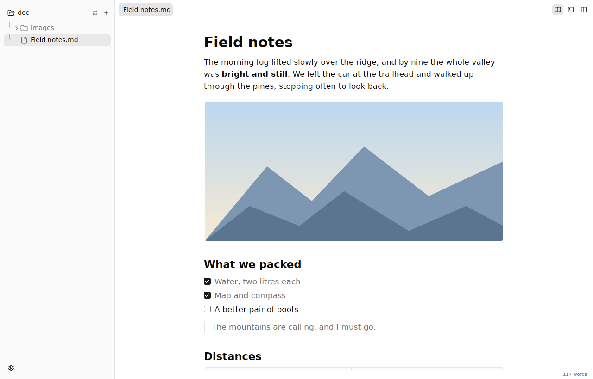
  </picture>
</p>

## Download

| Your computer | Download | Then |
|---|---|---|
| **Mac** (Apple silicon or Intel) | [enso-macos.dmg](../../releases/latest/download/enso-macos.dmg) | Open it and drag **enso** onto **Applications**. |
| **Windows** | [enso-windows-x64-setup.exe](../../releases/latest/download/enso-windows-x64-setup.exe) | Run it and follow the steps. |
| **Ubuntu, Debian, Mint, Pop!_OS** | [enso-linux-amd64.deb](../../releases/latest/download/enso-linux-amd64.deb) | Double-click it and choose **Install**. |
| **Other Linux** | [enso-linux-x86_64.AppImage](../../releases/latest/download/enso-linux-x86_64.AppImage) | Right-click › Properties › allow running as a program, then double-click it. |

Windows on ARM, ARM Linux, portable Windows zips and older versions are on the [releases page](../../releases).

**First launch.** If your Mac says it can't check enso for malicious software, open **System Settings › Privacy & Security** and click **Open Anyway**. If Windows shows "Windows protected your PC", click **More info › Run anyway**. You only need to do this once.

## Write in the page

Open any Markdown file and you see it typeset: headings, emphasis, lists, task lists, quotes, tables, code blocks, links and images. Click anywhere and type. There's no preview pane: the page you read is the page you edit, and the Markdown behind it changes only where you typed.

- **Selection that feels native:** drag across blocks with edge autoscroll, double-click for a word, triple-click for a paragraph, Shift-click or Shift-arrows to extend.
- **Copy as Markdown:** the clipboard gets the exact source behind your selection, so pasting into another Markdown file round-trips.
- **Formatting shortcuts:** bold, italic, strikethrough, code, links, headings, lists, task lists, quotes and code blocks. Each applies to the selection or the word at the caret, and pressing it again removes it.
- **Lists that continue:** Enter starts the next bullet, task or number; Enter on an empty item ends the list. Tab and Shift-Tab nest and un-nest.
- **Links and footnotes:** `[text][id]` resolves through its definition anywhere in the file, and editing the definition updates every link that uses it. ⌘-click (Ctrl-click) or ⌥Enter follows a link, and jumps from a footnote to its note and back.
- **One undo history:** undo and redo work the same in every view, and restore where you were.

<p align="center">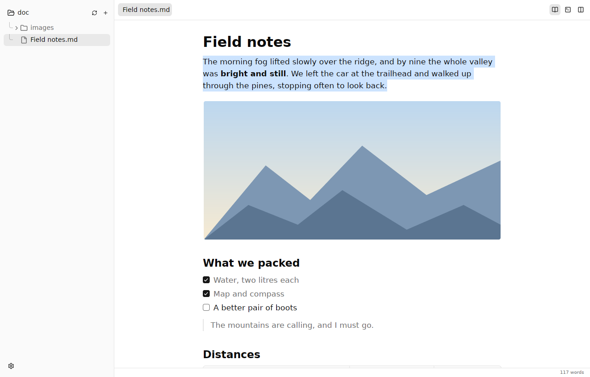</p>

## Source when you want it

⌘E switches between the page and syntax-highlighted Markdown. ⌘\\ puts them side by side, and pressing it again returns to the view you came from. The caret stays on the same character across views and stays at the same height on screen, so you never lose your place. In side by side, typing on either side updates the other immediately.

<p align="center">
  <picture>
    <source media="(prefers-color-scheme: dark)" srcset="assets/screenshots/side-dark.png">
    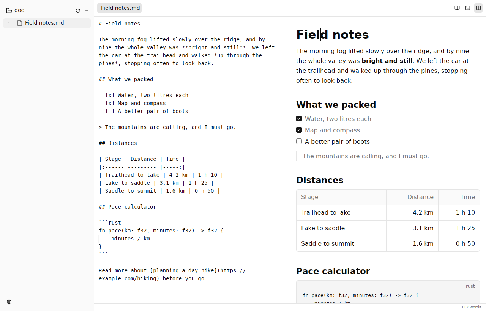
  </picture>
</p>

<p align="center">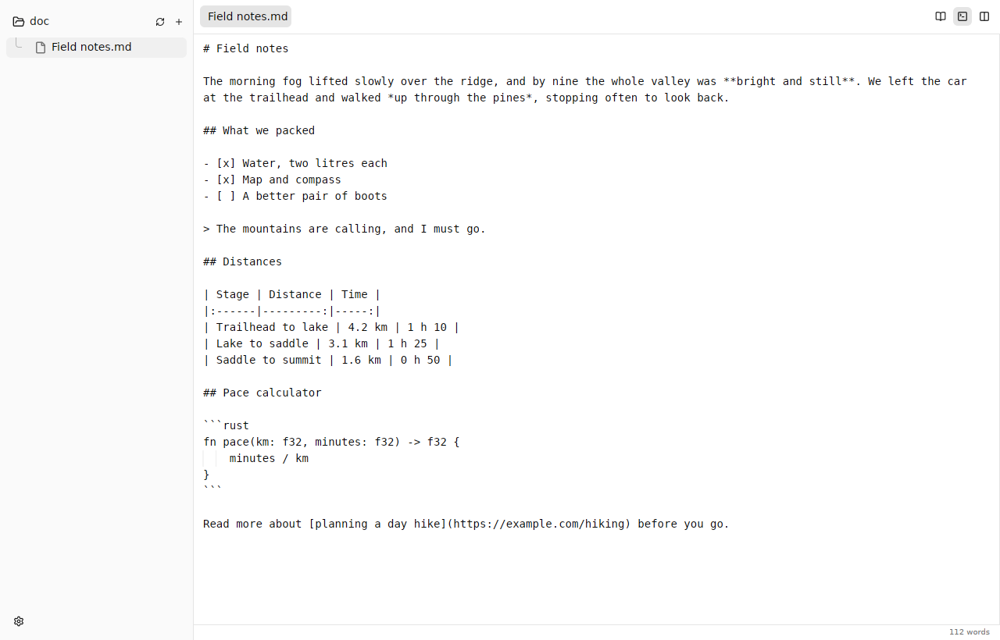</p>

## Writing modes

**Typewriter mode** keeps the line you are writing at one height on the screen, so your eyes stay put while the page moves. A dashed guide marks the line; drag it up or down and it settles back to the centre when you release near it. ⌘⇧T turns it on and off.

<p align="center">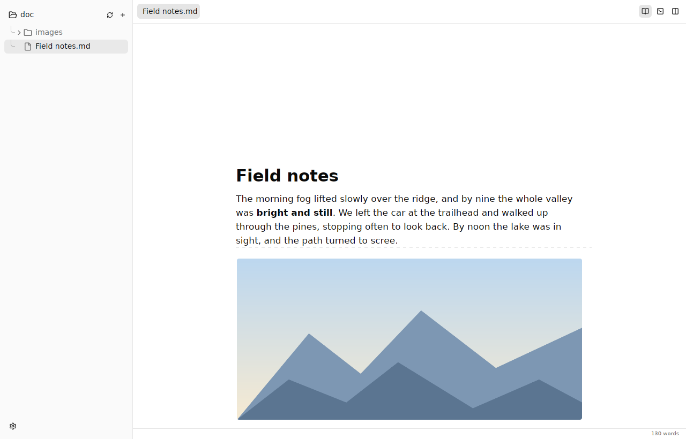</p>

**Focus** dims everything except the sentence or paragraph you are writing, and fades softly as you move between them. Sentences end where you expect, even after abbreviations like "Dr." or "e.g." and in Devanagari after the danda (।). ⌘⇧D cycles through off, sentence and paragraph.

<p align="center">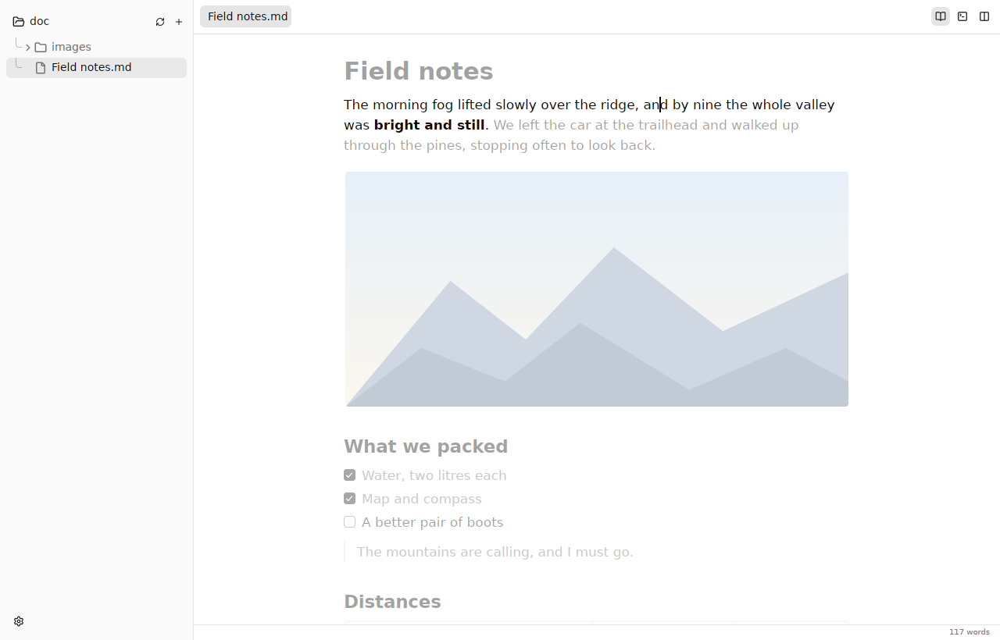</p>

While you type, the sidebar, tabs and status bar fade away and return as soon as you move the pointer or press Escape. The text column never moves.

## Images

Images sit in the page at their natural size, up to the width of the column. Click one to select it: drag the handle to resize it, align it left, centre or float it right, or open the image dialog to change its file, description and width. ⌘⇧I inserts a new image from a file or a URL, and pasting a screenshot saves it next to your notes.

enso writes a plain Markdown image whenever it can, and an HTML `` tag only when a size or alignment needs one. The dialog tells you which it will write.

<p align="center">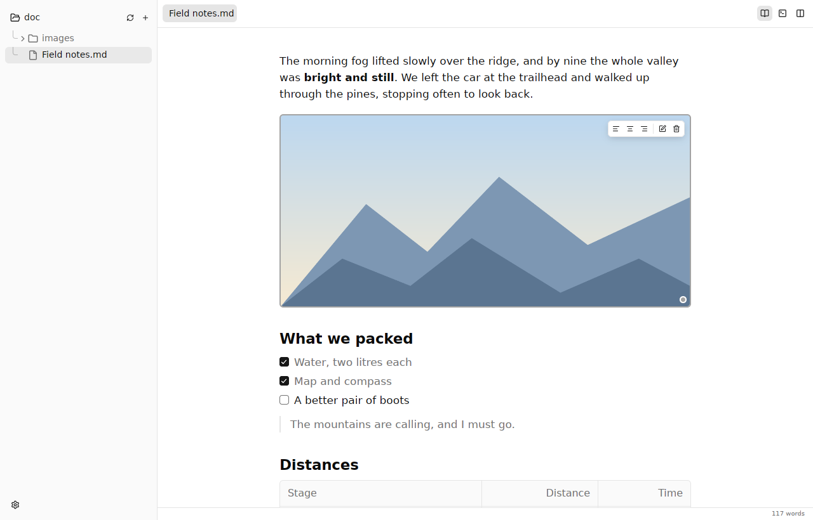</p>

<p align="center">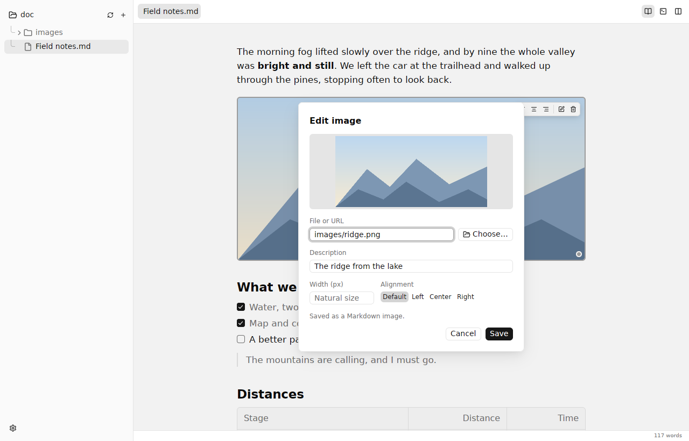</p>

## Tables

Click into a table and edit cells directly, including bold, links and code. Tab and Shift-Tab move between cells, and Tab on the last cell starts a new row. A small toolbar adds and removes rows and columns and tidies the column padding in the Markdown, all without moving the table.

<p align="center">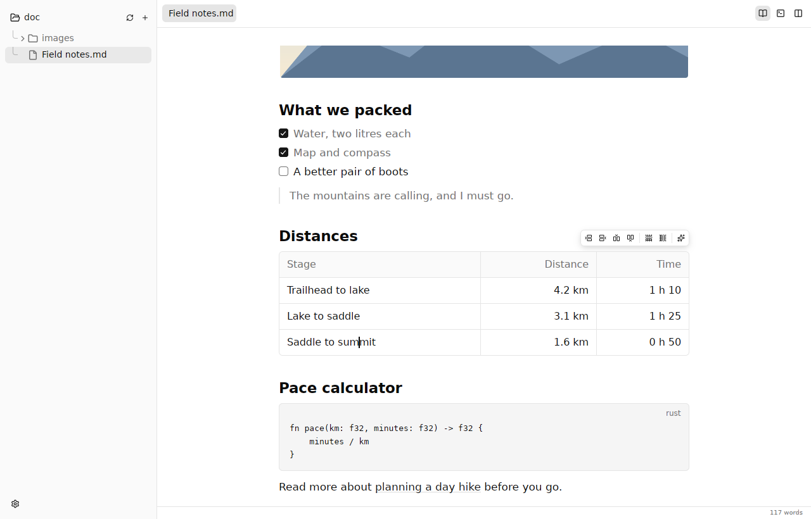</p>

## Math

Write LaTeX between dollar signs and it is typeset in the page: `$\nabla_\theta L$` inline, and `$$ … $$` on its own lines for display equations. Fractions, sums, integrals, roots, matrices, `\operatorname`, `\text` and the rest of everyday LaTeX math render with proper math fonts, offline, and follow the light or dark theme. Amounts like "$5 and $10" stay plain text.

<p align="center">
  <picture>
    <source media="(prefers-color-scheme: dark)" srcset="assets/screenshots/math-dark.png">
    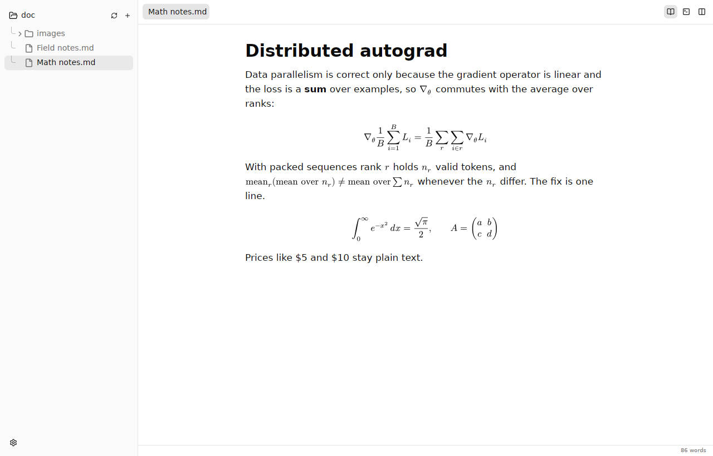
  </picture>
</p>

Click a display formula, or double-click an inline one, to edit it with a live preview; ⌘⇧M inserts a new formula. The file keeps plain `$…$` and `$$…$$`.

<p align="center">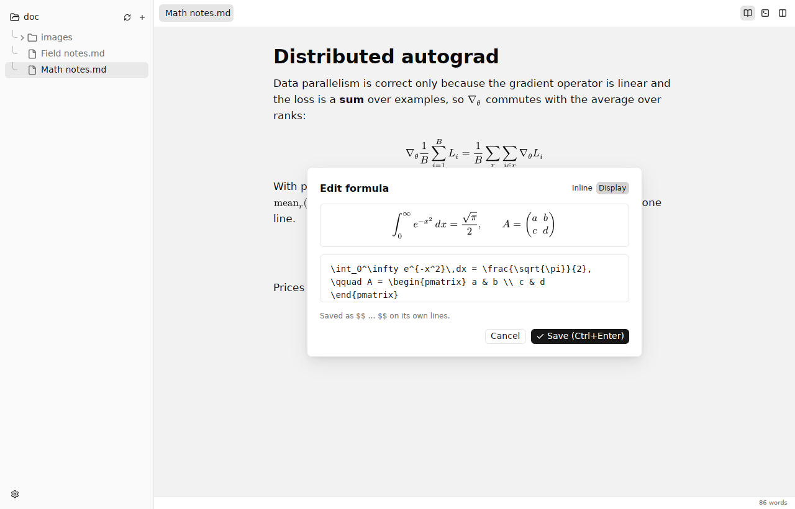</p>

## Front matter

YAML and TOML front matter opens in its own panel above the page, with syntax highlighting. Edit it there and the header of your file changes with it; fold the panel away when you don't need it.

<p align="center">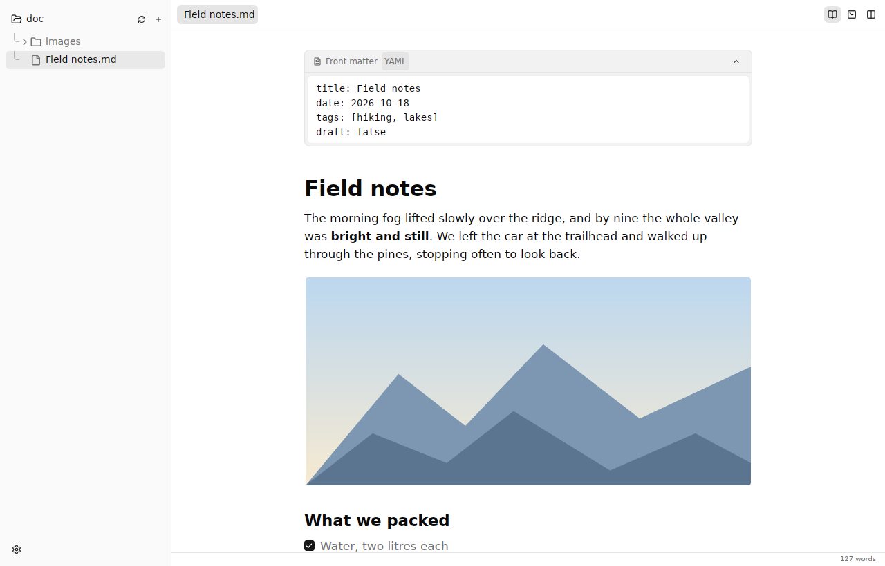</p>

## Make it yours

Choose the caret's colour, thickness, blink rate and blink pattern, the size of the text in the page, and how the page behaves while you write. Light and dark themes follow the system, or pick one yourself. On macOS, text is drawn crisply, the way current Mac apps draw it; Settings › Appearance can switch back to the heavier, older style.

<p align="center">
  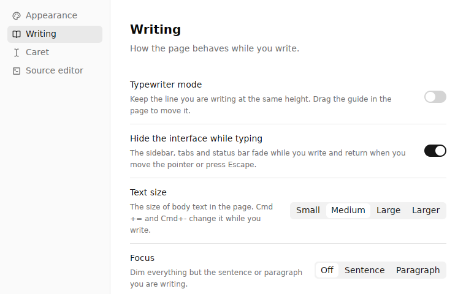
  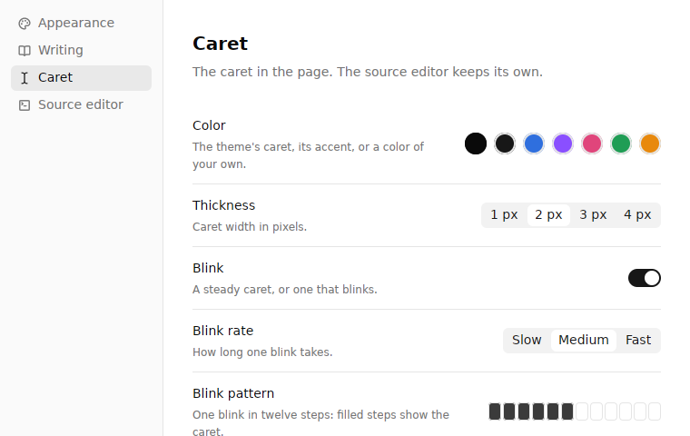
</p>

## Your files, untouched

- Documents are plain `.md` files. Opening a file and closing it without edits never writes it, byte for byte, including line endings, whitespace, list markers and emphasis style.
- A visual edit changes only the bytes of the blocks you touched. CRLF files stay CRLF.
- Saves happen automatically after 500 ms of quiet, are written in the background one at a time, and are flushed when you quit. ⌘S saves at once.
- If a file changes on disk while you have unsaved edits, enso keeps your text and tells you instead of overwriting either version.
- No account, no analytics, no network access except loading images your documents reference.

## Fast on long documents

Typing is built to fit inside a 120 Hz frame on documents of hundreds of kilobytes: edits reparse only the block they touch, and long lists and tables re-render only the rows that changed. Opening a long file shows the first screen at once and parses the rest in the background. Files over 256 KiB open in a section reader that lays out only what is on screen, and their source opens on demand.

## A workspace for notes

<p align="center">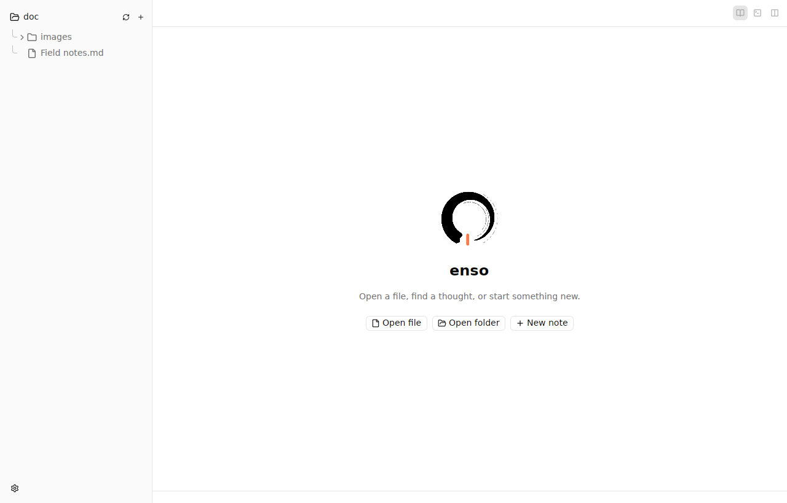</p>

- Open a folder as a workspace: browse it lazily, create, rename and delete files and folders (deletes go to the Trash or Recycle Bin).
- Tabs keep their edits while you switch between files and folders. Several windows can be open at once.
- Paste a screenshot or an image file and enso saves it into the workspace and links it.
- Relative images and links resolve against the document's folder. Web links open in your browser.
- On macOS, Quick Look previews Markdown files from Finder with the Space bar.

## Keyboard shortcuts

⌘ on macOS, Ctrl on Windows and Linux.

| App | |
|---|---|
| ⌘O / ⌘⇧O | Open file / open folder as a workspace |
| ⌘N / Ctrl⇧N | New file / new folder in the selected folder |
| Enter (F2 on Windows/Linux) | Rename the selected file or folder |
| ⌘⌫ (Delete on Windows/Linux) | Move the selected file or folder to the Trash |
| ⌘S | Save now |
| ⌘W | Close the current file |
| ⌘E | Switch between the page and the source |
| ⌘\\ | Side by side; press again to return |
| ⌘, | Settings |
| ⌘Q | Quit |

| Writing | |
|---|---|
| ⌘B / ⌘I | Bold / italic |
| ⌘⇧X | Strikethrough |
| ⌘⇧C | Inline code |
| ⌘K | Link |
| ⌘1 – ⌘6, ⌘0 | Heading level 1–6, back to body text |
| ⌘⇧8 / ⌘⇧7 / ⌘⇧L | Bullet, numbered or task list |
| ⌘Enter | Tick or untick a task |
| ⌘⇧. | Quote |
| ⌘⌥C | Code block |
| Tab / ⇧Tab | Nest / un-nest a list item |
| ⌘A, ⌘C, ⌘X, ⌘V | Select all, copy, cut and paste Markdown |
| ⌘Z / ⌘⇧Z | Undo / redo |
| ⌥Enter | Follow the link or footnote at the caret |
| ⌘⇧I | Insert or edit an image |
| ⌘⇧M | Insert a formula; ⌘Enter saves it |
| Tab / ⇧Tab in a table | Next / previous cell |
| ⌘⌥↑ / ⌘⌥↓ | Insert a table row above / below |
| ⌘⌥← / ⌘⌥→ | Insert a table column left / right |
| ⌘⌥⌫ / ⌘⌥⇧⌫ | Delete the table row / column |
| ⌘⌥T | Tidy the table's column padding |
| ⌘⇧T | Typewriter mode |
| ⌘⇧D | Focus: off, sentence, paragraph |
| ⌘= / ⌘- | Larger / smaller text |
| Escape | Bring back the sidebar and tabs |

The source editor also has ⌘F find, ⌘⇧F replace, ⌘] / ⌘[ to indent and outdent lines, and ⌥⌘↑ / ⌥⌘↓ to add cursors.

## Build from source on macOS

### 1. One-time setup

| Step | Command |
|---|---|
| Install Xcode from the App Store, open it once, accept the license | `sudo xcodebuild -license accept` |
| Use Xcode's tools (the Metal shader compiler and Swift) | `sudo xcode-select -s /Applications/Xcode.app` |
| Install Rust, then open a new terminal | `curl --proto '=https' --tlsv1.2 -sSf https://sh.rustup.rs \| sh` |

`rust-toolchain.toml` pins the Rust version; rustup downloads it on the first build.

With Xcode 26 or later the app gets the layered icon that follows the macOS 26 Dock styles (default, dark, clear and tinted). Older Xcode versions fall back to a flat icon.

### 2. Get the code

```sh
git clone https://github.com/viai957/enso.git
cd enso
```

If the repository is private, let Cargo fetch the pinned `gpui-base` branch with your git login:

```sh
export CARGO_NET_GIT_FETCH_WITH_CLI=true
```

### 3. Run it

```sh
cargo run
cargo run -- /absolute/path/to/note.md
cargo run -- /absolute/path/to/folder
```

The first build takes several minutes; later builds are incremental.

### 4. Install the app

| Command | Result |
|---|---|
| `make app` | `target/enso.app` with its Quick Look extension |
| `make install` | Copies it to `/Applications` and registers Quick Look (Space-bar previews of Markdown in Finder) |
| `make build.macos` | A release build and a disk image, `target/enso-<version>-<arch>.dmg` |
| `make` | Lists every target |

The app is signed locally, not notarized: the first time, right-click `enso.app` and choose **Open**.

### Troubleshooting

| Problem | Fix |
|---|---|
| `xcrun: error: unable to find utility "metal"` | Install the full Xcode app and run the `xcode-select` command above |
| Cargo cannot fetch `gpui-base` | `export CARGO_NET_GIT_FETCH_WITH_CLI=true`, and check that `git clone` of this repository works |
| "enso can't be opened" | Right-click the app, choose **Open**, then confirm |

## Other platforms and releases

On Windows and Linux, `cargo run` works the same way once GPUI's build dependencies are installed (see below).

On the first launch without arguments, enso opens an editable `Get Started.md` from its application data folder.

## Releasing

Releases follow the version in `Cargo.toml` and are published from version tags (`v1.2.3`, or `v1.2.3-beta.1` for a pre-release).

```sh
make release VERSION=1.2.3
```

From an up-to-date, clean `main`, this sets the version, runs the tests, commits "Release v1.2.3", tags `v1.2.3` and pushes. The tag starts `.github/workflows/release.yml`, which builds every package and publishes the release with download instructions and the changes since the previous tag:

| File | For |
|---|---|
| `enso-macos.dmg` | macOS 11 or later, Apple silicon and Intel in one app, with the Quick Look preview |
| `enso-windows-x64-setup.exe`, `enso-windows-arm64-setup.exe` | Windows 10 and 11: per-user install, Start menu entry, optional desktop icon and `.md` association, uninstaller |
| `enso-windows-*-portable.zip` | Windows without installing |
| `enso-linux-amd64.deb`, `enso-linux-arm64.deb` | Ubuntu 22.04 or later and other Debian-based systems |
| `enso-linux-x86_64.AppImage`, `enso-linux-aarch64.AppImage` | Any recent Linux distribution |

File names don't change between versions, so `releases/latest/download/<file>` always links to the newest one. Running the workflow by hand from the Actions tab builds the same files into a private draft release for testing.

To sign and notarize the Mac app, so it opens without a warning, add these repository secrets (Settings › Secrets and variables › Actions): `MACOS_CERTIFICATE` (a Developer ID Application certificate exported as .p12, base64-encoded), `MACOS_CERTIFICATE_PASSWORD`, `APPLE_ID`, `APPLE_TEAM_ID` and `APPLE_APP_PASSWORD` (an app-specific password). Without them the app is signed ad hoc and macOS asks once on first launch.

## Platforms

One codebase for macOS, Windows and Linux on GPUI Kit's native backends. Linux needs GPUI's native build dependencies: a C/C++ toolchain, pkg-config, fontconfig, Wayland and X11 development libraries, and a working Vulkan driver.

GPUI Base is built from a pinned fork (`gpui-base-patched` in this repository) that exposes the editor host hooks the visual editor uses. `vendor/gpui-pre-macos` is the upstream 0.3.10 crate with three `Option::map_or_default` calls replaced by stable equivalents.

## Tests

```sh
cargo fmt --check
cargo check --locked
cargo test --locked
cargo test --locked --features ui-tests
./scripts/check-tokens.sh
```

Sizes, spacing, opacities and motion come from `src/tokens.rs`; the check above fails on new literal values anywhere else.
