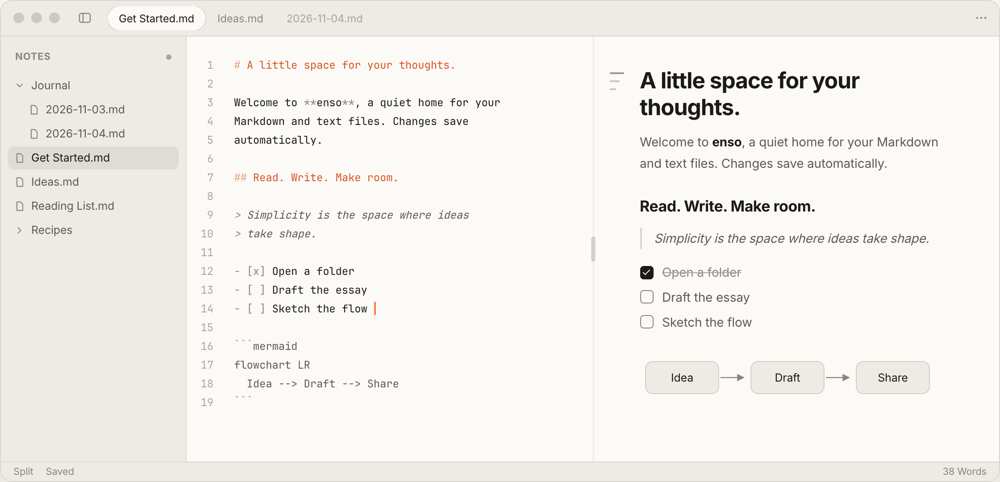

<div align="center">
  <picture>
    <source media="(prefers-color-scheme: dark)" srcset="assets/logo-light.png">
    
  </picture>
  <h1 align="center">enso</h1>
  <p align="center">A little space for your thoughts.</p>
  <i align="center">
    enso is a quiet, fast, native Markdown workspace. Read your notes like a book, write in plain text, and keep every page an ordinary file on your computer.
  </i>
  <br />
  <p align="center">
    Available for <strong>macOS</strong>, <strong>Windows</strong> & <strong>Linux</strong>.
  </p>
  <div>
    <a href="https://github.com/niraj-khatiwada/enso/releases">
      
    </a>
    <a href="https://github.com/niraj-khatiwada/enso/releases">
      
    </a>
    <a href="https://github.com/niraj-khatiwada/enso/releases">
      
    </a>
  </div>
  <br />
</div>

<div align="center">
  
</div>

### Install
Download enso for your platform from the [website](https://enso.codeforreal.com/#download) or the [releases](https://github.com/niraj-khatiwada/enso/releases) page.

<strong>Installer Info:</strong>

- `enso-<version>-arm64.dmg`: Macs with Apple Silicon
- `enso-<version>-x64.dmg`: Macs with an Intel processor
- `enso-<version>-windows-<arch>-setup.exe`: Windows installer
- `enso-<version>-windows-<arch>.zip`: Windows, portable
- `enso-<version>-linux-<arch>.AppImage`: Universal package for most Linux distros
- `enso-<version>-linux-<arch>.deb`: Debian derivatives of Linux like Ubuntu
- `enso-<version>-linux-<arch>.rpm`: Fedora, openSUSE and derivatives
- `enso-<version>-linux-<arch>.tar.gz`: Any Linux distro; unpack and run `./install.sh`

`<arch>` is `x64` for most computers and `arm64` for ARM ones.

> [!NOTE]
> By using enso, you acknowledge that it's not [notarized](https://developer.apple.com/documentation/security/notarizing_macos_software_before_distribution).
>
> Notarization is a "security" feature by Apple.
> You send binaries to Apple, and they either approve them or not.
> In reality, notarization is about paying $100 annual fee to Apple and building the app/binaries the way they want it.
>
> This is a free app. Paying the annual fee and notarizing the app to appease Apple is not feasible.
>
> macOS may say enso "is damaged and can't be opened" the first time; see the [FAQs](#faqs) for the one-line fix.

### Tech

enso is written in Rust🦀 with [GPUI](https://www.gpui.rs/) and [GPUI Kit](https://crates.io/crates/gpui-kit), and drawn by the GPU: no webview, no Electron. It's a single binary with its reading fonts bundled. Your notes stay plain Markdown files in your own folders, and nothing is sent anywhere: spell check runs on your computer, and the only network requests are web images in your notes and a daily check for a new version (both can be turned off in Settings).

### Building
Make sure the [Rust](https://rust-lang.org/) toolchain (1.95 or later) is installed. On Linux, also install GPUI's native libraries (a C/C++ toolchain, pkg-config, fontconfig, Wayland/X11 development libraries and a Vulkan driver).

Local Development:
```
cargo run
cargo run -- /path/to/note.md
cargo run -- /path/to/folder
```

Tests:
```
cargo test --locked --features ui-tests
```

Production Build:
- macOS: `make build.macos` makes `target/enso.app` and its disk image (`make` lists every target).
- Windows & Linux: `cargo build --release`; `scripts/package-linux.sh` makes the Linux packages.

Releases are built by `.github/workflows/release.yml` (Actions → Release → Run workflow) into a draft GitHub Release, with its notes from [CHANGELOG.md](./CHANGELOG.md).

### Callouts and math

GitHub-style `> [!NOTE]`, `> [!TIP]`, `> [!IMPORTANT]`, `> [!WARNING]` and `> [!CAUTION]` blocks render as quiet tinted panels. Obsidian-style custom titles are supported too.

Write inline math as `$x^2$` and display equations between `$$` lines. Fractions, roots, integrals, sums and matrices render natively and offline. HTML exports include self-contained SVG; PDF exports draw the equations as vector paths. Callout formatting is preserved in both formats. Unsupported equations keep their source visible.

### Linked notes

Type `[[` in Edit or Split view to search for another note in the current workspace. Use ↑/↓ and Enter or Tab to insert it, or click a suggestion. `[[Note.md|Display name]]` gives a link a different label; folder paths distinguish notes with the same name. New links include the file extension; older extensionless links remain supported.

Click a link in View to open its note. **Linked from** at the end of a note lists the notes that refer to it. The workspace watcher scans new and changed notes regardless of whether they arrive through enso, a file manager, or sync. It updates links for detected moves and renames, rebases copies when their origin can be identified, and repairs broken local paths with a unique workspace match. Ambiguous targets are left unchanged. Code examples and web URLs are left alone.

Link indexing and repairs run in the background. The index retains destinations and byte ranges, reparses only changed notes, and uses reverse references to find affected files. Large closed notes are rewritten through a temporary file without constructing a second full copy in memory.

### FAQs
<details>
<summary>
  <strong>macOS: "enso" is damaged and can't be opened. You should move it to trash.</strong>
</summary>
<p>
  This error is shown by Apple to gatekeep app developers from using their apps unless it's signed by Apple after paying $100/year fee. The message is completely misleading since the app is not damaged at all. Here's a simple solution for this issue. Open your terminal and run the command:
</p>

```
xattr -cr /Applications/enso.app
```
<p>
  If you don't feel comfortable applying the above solution, you can simply move the app to trash (which also means you cannot use enso on your Mac).
</p>
</details>
<details>
<summary>
  <strong>macOS: "enso" cannot be opened because developer cannot be verified.</strong>
</summary>
<p>
  This error is essentially the same as the one above. Apple just displays a different message to warn users about unverified developers. Run the same command:
</p>
<pre><code>xattr -cr /Applications/enso.app
</code></pre>
<p>
  If you don't want to run the command, you can right-click the app and select "Open" to bypass the warning, or move the app to trash.
</p>
</details>
<details>
<summary>
  <strong>Windows: Microsoft Defender SmartScreen prevented an unrecognized app from starting.</strong>
</summary>
<p>
  This happens because you downloaded the installer from an outside source. Windows Defender warns you before running any unknown app. You can safely install enso by clicking "More Info" and then selecting "Run Anyway".
</p>
</details>
<details>
<summary>
  <strong>Linux: the AppImage doesn't start.</strong>
</summary>
<p>
  Some distros, such as Ubuntu 24.04, need FUSE 2 for AppImages: install <code>libfuse2</code> (<code>sudo apt install libfuse2t64</code> on Ubuntu 24.04). Or use the <code>.deb</code>, <code>.rpm</code> or <code>.tar.gz</code> instead. enso also needs a working Vulkan driver.
</p>
</details>
<details>
<summary>
  <strong>Linux: spell check isn't working.</strong>
</summary>
<p>
  On Linux, enso uses Enchant 2 and an installed dictionary, for example <code>libenchant-2-2</code> and <code>hunspell-en-us</code> on Debian and Ubuntu.
</p>
</details>

### License

The project is licensed under the MIT License. The bundled reading fonts (Inter, Lora, JetBrains Mono, Poppins and Fira Code) are under the SIL Open Font License; see [assets/font-licenses.txt](./assets/font-licenses.txt).
